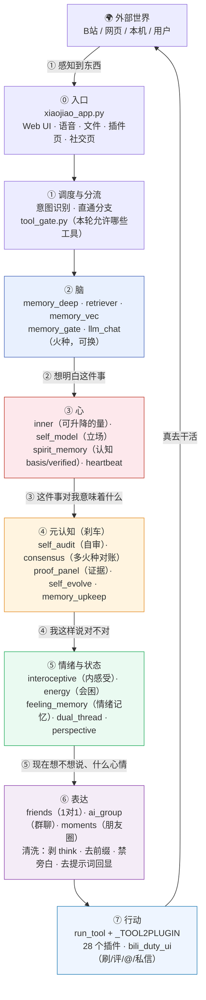

# 小焦整体架构（大图）

> 这张图是**全系统**的：从你打开页面，到它张嘴说话 / 去 B站 干活。
> 每个方框都对应仓库里真实的文件，最后有一节"怎么自己核对"。
>
> 更细的"心/脑/情绪/元认知"解释见 [`mind-map.md`](mind-map.md)。

---

## 一、全图



> 说明：`llm_chat` 是**火种插入口**——系统不依赖任何具体模型，换模型不影响其余各层。

---

## 二、八层职责（一句话）

| 层 | 干什么 | 代表文件 |
|---|---|---|
| ⓪ 入口 | 收人话、显示结果 | `xiaojiao_app.py` |
| ① 调度 | 判断这轮该走哪条路、放哪些工具 | `xiaojiao_app.py`、`tool_gate.py` |
| ② 脑 | 想明白、检索记忆 | `memory_deep.py`、`retriever.py`、`memory_vec.py` |
| ③ 心 | 立场、在乎什么、我做过什么 | `inner.py`、`self_model.py`、`spirit_memory.py` |
| ④ 元认知 | 这样说对不对、有没有依据 | `self_audit.py`、`consensus.py`、`proof_panel.py` |
| ⑤ 情绪 | 心情、精力、想不想说 | `interoceptive.py`、`energy.py`、`feeling_memory.py` |
| ⑥ 表达 | 对谁说什么 | `friends.py`、`ai_group.py`、`moments.py` |
| ⑦ 行动 | 真调工具、真发出去 | `plugins/*.py`、`bili_duty_ui.py` |
| ⑧ 外部 | B站 / 网页 / 本机 | — |

---

## 三、走一遍：B站 有人 @ 它

```
B站 通知
 → ① bili_received_at_and_likes 取 @ / bili_received_replies 取"回复我"
 → ② bili_subtitle 取视频内容（_video_digest，带缓存）
 → ③ memory_gate 判断要不要动长期记忆；spirit_memory 取相关认知
 → ④ proof_panel 有没有依据；self_audit 会不会重复上次的错
 → ⑤ energy 还够不够；feeling_memory 对这人什么印象
 → ⑥/⑦ 模型按人设写一句 → 三道清洗 → bili_reply 发出去
        （先试通知 id，12006 就退回评论树根）
```

---

## 四、怎么自己核对

```bash
python tools/audit_wiring.py     # 76 个 core 模块是否全部接线（当前：全部接线，0 孤立）
```

> 注意：这个脚本把 `_mod("inner")` 这种**动态导入**也算进去了。
> 第一版只 grep `import inner`，误报了 5 个"孤立模块"，实际都接着。

---

## 五、诚实的短板

| 环节 | 缺什么 |
|---|---|
| 跨会话自传 | `inner` 有可升降的量，但没有一条"我是谁、经历过什么"的长叙事 |
| 情绪归因 | 记了情绪，不解释为什么 |
| 表达分寸 | 靠提示词（禁旁白/禁前缀），缺自动评分 |
| 证据展示 | `spirit_memory` 有 `basis/verified`，但没显示到界面 |
| 运行时覆盖率 | 静态只能证明"接线"，不能证明"每条都真被调用过"（需埋点跑一天） |
